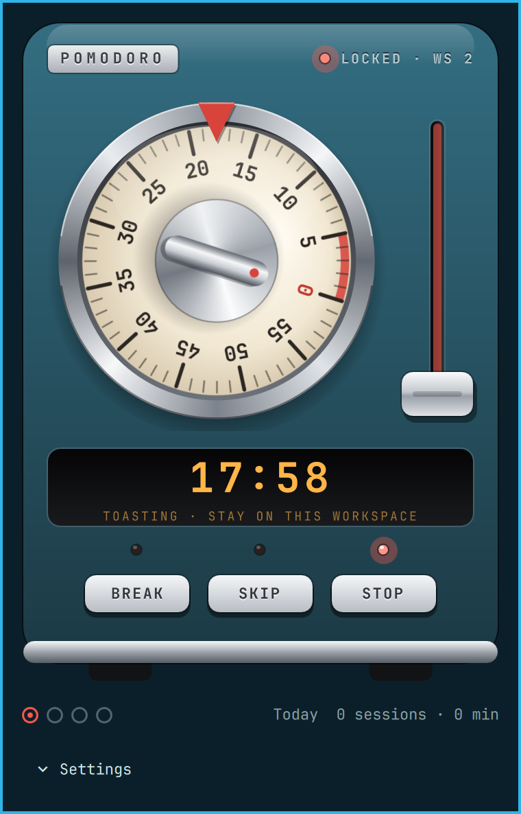

# Pomodoro

A pomodoro timer for the Omarchy bar, built like a little toaster. Twist the
kitchen-timer dial to set how long to focus, push the lever down to start, and
it pops back up when the time is done.

While a focus session runs, **you're locked to the workspace you started it
on.** Switching to another workspace, opening the scratchpad, or jumping to
another monitor bounces you straight back.



## Install

```bash
omarchy plugin add https://github.com/21J3phy/omarchy-pomodoro --enable
```

Requires `python3` (already on Omarchy) and Hyprland 0.56 or newer, which has
the Lua dispatchers.

## Use

- **Click** the timer in the bar to open the toaster.
- **Twist the dial** (drag it clockwise, or scroll) to set the focus length,
  from 1 to 60 minutes.
- **Push the lever down** to start. Pull it up twice to give up.
- **BREAK / SKIP / STOP** do what they say. STOP needs a second press during
  focus.
- **Right-click** the bar icon to start a session straight away.

In the bar, a running timer is a small dial whose wedge is the time left. It's
red while you focus and green on a break, with the minutes beside it.

When focus ends you get a chime, the break starts on its own, and the
workspace unlocks. When the break ends, the notification has a **Start focus**
button. The row of pips counts sessions toward the next long break.

### Settings

Under **Settings** in the panel:

- break lengths and how often the long break comes
- **Lock to workspace**: on by default
- **Strict mode**: the lever locks and STOP/SKIP stop working until the timer
  ends
- **Start breaks automatically**

## CLI

The panel drives `bin/pomodoro`, which you can also use directly:

```
bin/pomodoro start [minutes]    # focus, locked to the current workspace
bin/pomodoro break [minutes]
bin/pomodoro skip | stop | status
bin/pomodoro stop --force       # escape hatch for strict mode
bin/pomodoro set short 10       # focus, short, long, longEvery, lock, strict, autoBreak
```

Settings live in `~/.config/omarchy/pomodoro.json`, daily stats in
`~/.local/state/omarchy-pomodoro/stats.json`, and the running session in
`$XDG_RUNTIME_DIR/omarchy-pomodoro/`.

## How the lock works

`pomodoro start` starts a small daemon that reads Hyprland's event socket
(`.socket2.sock`). When a `workspacev2`, `focusedmonv2` or `activespecialv2`
event leaves the locked workspace, it dispatches
`hl.dsp.focus({ workspace = "<id>" })` or closes the special workspace. It also
checks the active workspace every two seconds in case it missed an event. The
daemon exits when no session is running.

## License

MIT
